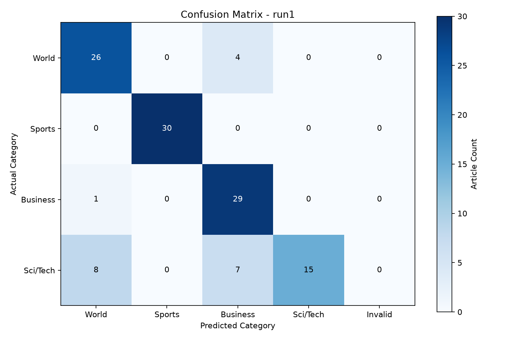

# run1 Analysis

Samples: 120
Accuracy: 83.33%
Errors: 20

## Category Accuracy

| Category | Correct / Total | Accuracy |
|---|---:|---:|
| World | 26/30 | 86.67% |
| Sports | 30/30 | 100.00% |
| Business | 29/30 | 96.67% |
| Sci/Tech | 15/30 | 50.00% |

## Confusion Matrix

## Error Patterns

| Actual -> Predicted | Count |
|---|---:|
| Sci/Tech -> World | 8 |
| Sci/Tech -> Business | 7 |
| World -> Business | 4 |
| Business -> World | 1 |

## Individual Errors

Possible reasons are heuristic hypotheses, not verified explanations.

| ID | Actual -> Predicted | Potential Reason |
|---:|---|---|
| 0 | World -> Business | Possible overlap between international affairs and commercial developments. Text clues: market |
| 1 | Business -> World | Possible overlap between economic activity and international affairs. Manual review recommended. |
| 2 | Sci/Tech -> World | Possible overlap between science/technology and government, legal or international news. Text clues: internet, government |
| 8 | Sci/Tech -> World | Possible overlap between science/technology and government, legal or international news. Text clues: discover, peru |
| 9 | Sci/Tech -> World | Possible overlap between science/technology and government, legal or international news. Text clues: scientist |
| 22 | Sci/Tech -> World | Possible overlap between science/technology and government, legal or international news. Text clues: evolution, trial, law |
| 48 | Sci/Tech -> Business | Possible overlap between technology products and company, market or finance news. Text clues: company, earnings |
| 53 | Sci/Tech -> Business | Possible overlap between technology products and company, market or finance news. Text clues: playstation, game console, price, cost, japan |
| 75 | Sci/Tech -> World | Possible overlap between science/technology and government, legal or international news. Text clues: internet, computer, prosecut |
| 76 | Sci/Tech -> Business | Possible overlap between technology products and company, market or finance news. Text clues: network, market, acquisition |
| 77 | Sci/Tech -> Business | Possible overlap between technology products and company, market or finance news. Text clues: playstation, market, company, japan |
| 82 | Sci/Tech -> World | Possible overlap between science/technology and government, legal or international news. Text clues: government |
| 83 | World -> Business | Possible overlap between international affairs and commercial developments. Manual review recommended. |
| 86 | Sci/Tech -> Business | Possible overlap between technology products and company, market or finance news. Text clues: software, market, business |
| 90 | Sci/Tech -> World | Possible overlap between science/technology and government, legal or international news. Text clues: internet, web, japan |
| 93 | Sci/Tech -> Business | Possible overlap between technology products and company, market or finance news. Text clues: processor, company |
| 101 | Sci/Tech -> Business | Possible overlap between technology products and company, market or finance news. Text clues: software, sales, police |
| 111 | Sci/Tech -> World | Possible overlap between science/technology and government, legal or international news. Manual review recommended. |
| 112 | World -> Business | Possible overlap between international affairs and commercial developments. Text clues: sales |
| 118 | World -> Business | Possible overlap between international affairs and commercial developments. Text clues: government, law |
