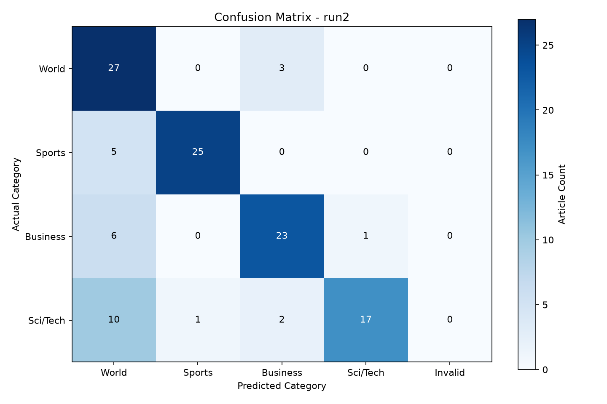

# run2 Analysis

Samples: 120
Accuracy: 76.67%
Errors: 28

## Category Accuracy

| Category | Correct / Total | Accuracy |
|---|---:|---:|
| World | 27/30 | 90.00% |
| Sports | 25/30 | 83.33% |
| Business | 23/30 | 76.67% |
| Sci/Tech | 17/30 | 56.67% |

## Confusion Matrix

## Error Patterns

| Actual -> Predicted | Count |
|---|---:|
| Sci/Tech -> World | 10 |
| Business -> World | 6 |
| Sports -> World | 5 |
| World -> Business | 3 |
| Sci/Tech -> Business | 2 |
| Business -> Sci/Tech | 1 |
| Sci/Tech -> Sports | 1 |

## Individual Errors

Possible reasons are heuristic hypotheses, not verified explanations.

| ID | Actual -> Predicted | Potential Reason |
|---:|---|---|
| 0 | World -> Business | Possible overlap between international affairs and commercial developments. Text clues: market |
| 1 | Business -> World | Possible overlap between economic activity and international affairs. Manual review recommended. |
| 2 | Sci/Tech -> World | Possible overlap between science/technology and government, legal or international news. Text clues: internet, government |
| 3 | Sci/Tech -> World | Possible overlap between science/technology and government, legal or international news. Manual review recommended. |
| 4 | Sci/Tech -> World | Possible overlap between science/technology and government, legal or international news. Manual review recommended. |
| 8 | Sci/Tech -> World | Possible overlap between science/technology and government, legal or international news. Text clues: discover, peru |
| 12 | Business -> World | Possible overlap between economic activity and international affairs. Manual review recommended. |
| 13 | Sports -> World | Potentially ambiguous topic, incomplete article or dataset labeling convention. Manual review recommended. |
| 21 | Business -> World | Possible overlap between economic activity and international affairs. Text clues: company, price, court |
| 22 | Sci/Tech -> World | Possible overlap between science/technology and government, legal or international news. Text clues: evolution, trial, law |
| 29 | Business -> World | Possible overlap between economic activity and international affairs. Manual review recommended. |
| 38 | Business -> World | Possible overlap between economic activity and international affairs. Text clues: research, company, law |
| 48 | Sci/Tech -> Business | Possible overlap between technology products and company, market or finance news. Text clues: company, earnings |
| 55 | Sports -> World | Potentially ambiguous topic, incomplete article or dataset labeling convention. Manual review recommended. |
| 61 | Business -> Sci/Tech | Potentially ambiguous topic, incomplete article or dataset labeling convention. Manual review recommended. |
| 64 | Sports -> World | Potentially ambiguous topic, incomplete article or dataset labeling convention. Text clues: network |
| 77 | Sci/Tech -> Sports | Potentially ambiguous topic, incomplete article or dataset labeling convention. Text clues: playstation, market, company, japan |
| 78 | Sci/Tech -> World | Possible overlap between science/technology and government, legal or international news. Text clues: internet |
| 82 | Sci/Tech -> World | Possible overlap between science/technology and government, legal or international news. Text clues: government |
| 83 | World -> Business | Possible overlap between international affairs and commercial developments. Manual review recommended. |
| 85 | Sci/Tech -> World | Possible overlap between science/technology and government, legal or international news. Manual review recommended. |
| 86 | Sci/Tech -> Business | Possible overlap between technology products and company, market or finance news. Text clues: software, market, business |
| 89 | Sports -> World | Potentially ambiguous topic, incomplete article or dataset labeling convention. Manual review recommended. |
| 90 | Sci/Tech -> World | Possible overlap between science/technology and government, legal or international news. Text clues: internet, web, japan |
| 91 | Business -> World | Possible overlap between economic activity and international affairs. Text clues: government |
| 111 | Sci/Tech -> World | Possible overlap between science/technology and government, legal or international news. Manual review recommended. |
| 112 | World -> Business | Possible overlap between international affairs and commercial developments. Text clues: sales |
| 114 | Sports -> World | Potentially ambiguous topic, incomplete article or dataset labeling convention. Manual review recommended. |
