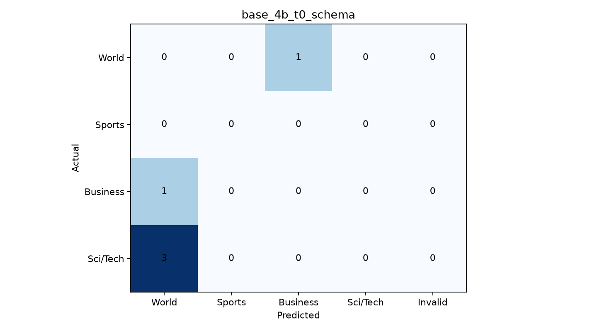

# base_4b_t0_schema

**0/5 doğru**, **5 yanlış**, accuracy: **%0.0**
Ham JSON: 5/5 | Şema uygun: 5/5 | Temizlikle kurtarılan: 0

## Kategori sonuçları

| Kategori | Doğru / Toplam |
|---|---:|
| World | 0/1 |
| Sports | 0/0 |
| Business | 0/1 |
| Sci/Tech | 0/3 |

## Confusion matrix

## Yanlış tahminler (nedenler doğrulanmış değil, hipotez)
| ID | Gerçek → Tahmin | Olası sebep |
|---:|---|---|
| 0 | World → Business | Uluslararası olay ve ticari boyut karışmış olabilir. |
| 1 | Business → World | Ekonomi ve uluslararası gelişme ayrımı belirsiz olabilir. |
| 2 | Sci/Tech → World | Bilim/teknoloji konusu dünya gündemiyle karışmış olabilir. |
| 3 | Sci/Tech → World | Bilim/teknoloji konusu dünya gündemiyle karışmış olabilir. |
| 4 | Sci/Tech → World | Bilim/teknoloji konusu dünya gündemiyle karışmış olabilir. |
