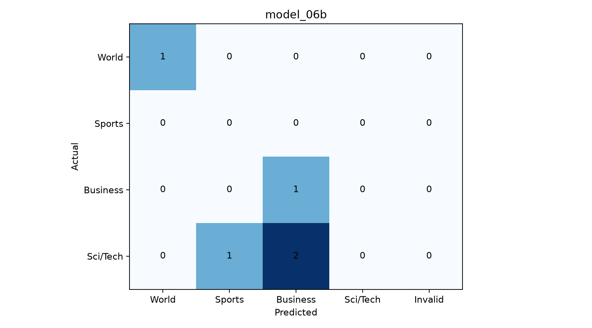

# model_06b

**2/5 doğru**, **3 yanlış**, accuracy: **%40.0**
Ham JSON: 5/5 | Şema uygun: 5/5 | Temizlikle kurtarılan: 0

## Kategori sonuçları

| Kategori | Doğru / Toplam |
|---|---:|
| World | 1/1 |
| Sports | 0/0 |
| Business | 1/1 |
| Sci/Tech | 0/3 |

## Confusion matrix

## Yanlış tahminler (nedenler doğrulanmış değil, hipotez)
| ID | Gerçek → Tahmin | Olası sebep |
|---:|---|---|
| 2 | Sci/Tech → Business | Teknolojik ürün ve ticari faaliyet odağı karışmış olabilir. |
| 3 | Sci/Tech → Sports | Kısa/belirsiz haber veya kategori sınırı; elle incele. |
| 4 | Sci/Tech → Business | Teknolojik ürün ve ticari faaliyet odağı karışmış olabilir. |
