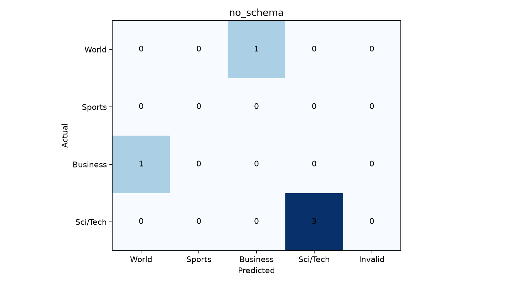

# no_schema

**3/5 doğru**, **2 yanlış**, accuracy: **%60.0**
Ham JSON: 0/5 | Şema uygun: 5/5 | Temizlikle kurtarılan: 5

## Kategori sonuçları

| Kategori | Doğru / Toplam |
|---|---:|
| World | 0/1 |
| Sports | 0/0 |
| Business | 0/1 |
| Sci/Tech | 3/3 |

## Confusion matrix

## Yanlış tahminler (nedenler doğrulanmış değil, hipotez)
| ID | Gerçek → Tahmin | Olası sebep |
|---:|---|---|
| 0 | World → Business | Uluslararası olay ve ticari boyut karışmış olabilir. |
| 1 | Business → World | Ekonomi ve uluslararası gelişme ayrımı belirsiz olabilir. |
